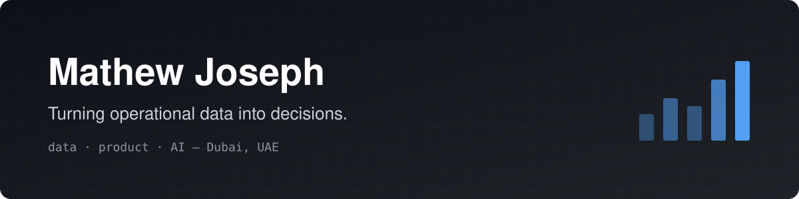

 

 

**Day job** &nbsp;·&nbsp; Data Specialist, Transformation Office at **Emirates Transport**: fleet, fuel and maintenance analytics  
**Building** &nbsp;·&nbsp; [Beans](https://trackyourbeans.com), a simple way to track where your money goes  
**Learning** &nbsp;·&nbsp; Building AI agents that do real work, starting with an automated daily news briefing  
**Before** &nbsp;·&nbsp; Business Analyst at LSEG · COO at Making Today · QA Automation at Envestnet  
**Ask me about** &nbsp;·&nbsp; Fleet data, golf, and training for a half marathon

 

<b><ins>DATA & ANALYTICS</ins></b> 

       
<b>Methods</b> &nbsp;·&nbsp; KPI design · Dashboards · Business cases · Root-cause analysis · Data quality checks

 

<b><ins>BUSINESS & PRODUCT</ins></b> 

      
<b>Practice</b> &nbsp;·&nbsp; BRDs and requirements · Stakeholder management · Process mapping · Scope of work · Board-ready reporting

 

<b><ins>AI</ins></b> 

    

 

<b><ins>BUILDING</ins></b> 

      

 

&nbsp;&nbsp;&nbsp;&nbsp;
